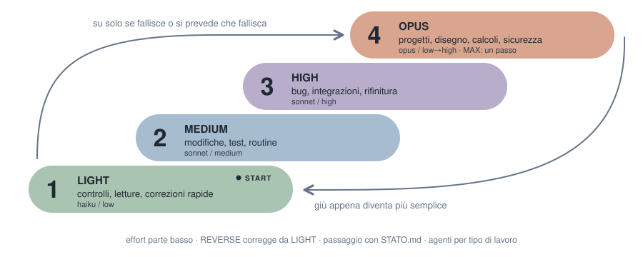
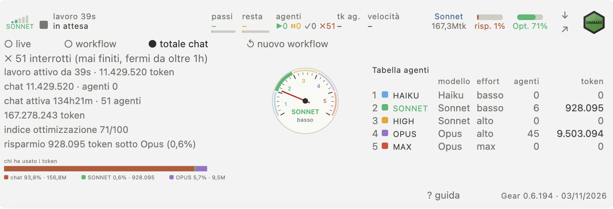

# ONMAKE Gear (italiano)

Il modello giusto al momento giusto per il compito dato, con l'effort allineato al compito: un lavoro ottimo con token ottimizzati, verso il risparmio, con qualità di lavoro eccellente.




## Cosa fa (IT)

All'avvio di ogni sessione di Claude Code, ONMAKE Gear dà alla sessione una regola:

- sceglie la coppia modello + effort più bassa che garantisce qualità eccellente;
- sale se il controllo fallisce o il compito è più difficile, scende a passo difficile finito;
- per un passo molto complesso usa un picco di effort, solo per quel passo, poi torna alla coppia normale;
- tiene un file `STATO.md` breve per ogni lavoro (deciso, fatto, manca, file toccati), da leggere a inizio sessione al posto della conversazione intera;
- cambia modello solo tra un'operazione e l'altra, e avvisa in una riga.

| Livello | Modello | Effort | Agenti per tipo di lavoro |
|---|---|---|---|
| LIGHT | Haiku | basso | `gear-reader` (letture, ricerche, stato), `gear-tester` (test e controlli) |
| MEDIUM | Sonnet | basso, poi medio | `gear-editor` (file e righe noti), `gear-writer` (testi, documentazione) |
| HIGH | Sonnet | basso, poi alto | `gear-debugger` (bug da capire), `gear-reviewer` (revisione del codice) |
| OPUS | Opus | basso, poi alto | `gear-designer` (interfacce), `gear-architect` (progetti), `gear-standards` e `gear-security` (partono da medio) |
| MAX | Opus | massimo, un solo passo | `gear-max` |

Il tipo di lavoro sceglie il modello; l'effort parte basso quando il lavoro si può fare così e sale solo se il controllo fallisce. I progetti (progettazione, architettura, un'interfaccia nuova) partono direttamente da OPUS. REVERSE corregge gli errori partendo da LIGHT.

La chat decide, fase per fase, quale modello conviene al lavoro e può affidare una fase all'agente gear corrispondente; è un suggerimento alla chat, non un obbligo.

## Installazione

```
claude plugin marketplace add MaxTulli70/ONMAKE.Gear
claude plugin install onmake-gear@onmake
```

Versione 0.6.89, in prova.

**Barra e pannello.** In Claude Code una barra sopra il campo di scrittura mostra, nella riga principale (desktop):
- cinque barre di marcia da LIGHT a MAX con quella attuale piena, il nome della marcia e una freccia con l'ultimo salto, su o giù;
- durante il lavoro lo strumento attuale e il bersaglio con la durata, oppure "thinking"; a riposo "ready";
- il modello della chat, una barra di effort (low, medium, high, max), i token per modello o il totale e l'indice di ottimizzazione.

Pulsanti: il logo ONMAKE apre onmake.it; la freccia apre il menu a tendina; ↗ apre il pannello HTML nel browser.

<p align="center"></p>

<p align="center"></p>

Il menu a tendina ha tre viste: live (dall'inizio del turno attuale), workflow (dal reset salvato) e chat totale (tutta la chat). Contiene il contachilometri, un quadrante con le zone L M H O X e una lancetta che segue marcia ed effort (4 passi di effort per marcia).

L'indice di ottimizzazione va da 0 a 100. Pesi: agenti light 1, medium 2, high 3, opus 5; chat Haiku 1, Sonnet 2, altro 5. Verde da 50, giallo da 20. Il risparmio mostra i token fatti dagli agenti light, medium e high con la percentuale sul totale.

"↺ nuovo workflow" chiede conferma (OK / annulla); la domanda sparisce dopo 6 secondi. Il reset non cancella la chat, riparte solo la vista workflow.

Lingue: italiano (predefinita), inglese, tedesco, francese, spagnolo, da scegliere nella guida; "? guida" apre una breve spiegazione.

I dati si aggiornano al massimo ogni 8 secondi e sono letti dalle trascrizioni locali, senza rete. I prezzi sono in `~/.config/onmake-gear/prezzi.json`.

Pannello: `python3 onmake-gear/scripts/pannello.py --cartella DIR [--sessione ID] [--json | --html FILE]`, oppure `/gear-pannello`.

**Riga di stato.** Mostra la marcia attuale, es. `⚙ LIGHT ▼` (freccia = ultimo salto su/giù, `⚙ –` = nessun sotto-agente gear). L'app desktop non la mostra; nel terminale si attiva così: in `~/.claude/settings.json` metti `statusLine` = `{"type":"command","command":"python3 /percorso/onmake-gear/scripts/statusline.py"}`.

## Contatore token
`python3 onmake-gear/scripts/contatore.py [trascrizione.jsonl]` mostra i token per modello e per livello gear (solo python3 standard). Claude Code salva l'uso dei sotto-agenti in file propri (`<sessione>/subagents/agent-*.jsonl`, tipo nel `.meta.json`): i sotto-agenti sono contati a parte e la chat principale è una riga sola. I duplicati dello streaming sono uniti per id messaggio.

## Altre AI
Per opencode, DeepSeek Harness (dsh), Codex, Gemini, Cursor: `sh portabile/installa-altre-ai.sh` aggiunge un blocco di regole compatto (`portabile/GEAR-corto.md`) ai loro file di istruzioni esistenti, con backup `*.prima-gear`, ripetibile senza effetti. Per toglierlo: `sh portabile/installa-altre-ai.sh --togli`.

Per Codex c'è una versione apposita, `portabile/GEAR-codex.md`: GPT-6.1 Terra per LIGHT e MEDIUM, GPT-6.1 Sol per HIGH, OPUS e MAX, con i livelli di ragionamento di Codex (Light, medio, alto, molto alto, max; mai ultra). Va incollata in `~/.codex/AGENTS.md`.
