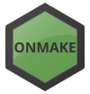
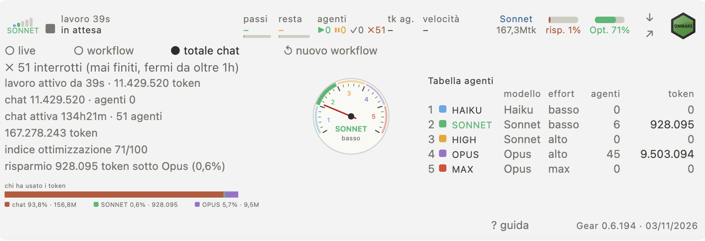

<p align="center"><a href="https://www.onmake.it"></a></p>

# ONMAKE Gear

<p align="center"><a href="https://www.onmake.it">www.onmake.it</a></p>

The right model at the right moment for the task at hand, with effort matched to the task: excellent work, optimised tokens, always leaning to saving, with excellent quality.


**What it does.** At the start of every Claude Code session, ONMAKE Gear gives the session a rule: pick the lowest model + effort pair that guarantees excellent quality; go up if a check fails, go down when the hard step is done; use a short peak of maximum effort only for the essential step; keep a short `STATO.md` per job; switch model only between operations and say so in one line; REVERSE gear fixes errors starting from the lowest level. The rule in `portabile/GEAR.md` is portable and works with any AI.

| Level | Model | Effort | Agents by type of work |
|---|---|---|---|
| LIGHT | Haiku | low | `gear-reader` (reads, search, status), `gear-tester` (tests, checks) |
| MEDIUM | Sonnet | low, then medium | `gear-editor` (known files and lines), `gear-writer` (texts, docs) |
| HIGH | Sonnet | low, then high | `gear-debugger` (unknown bugs), `gear-reviewer` (code review) |
| OPUS | Opus | low, then high | `gear-designer` (interfaces), `gear-architect` (projects), `gear-standards` and `gear-security` (start at medium) |
| MAX | Opus | max, one step only | `gear-max` |

The type of work picks the model; effort starts low whenever the job can be done that way and goes up only when the check fails. Projects (design, architecture, a new interface) start directly at OPUS. REVERSE fixes errors starting from LIGHT.

The chat decides, phase by phase, which model suits the work and can hand a phase to the matching gear agent; this is a suggestion to the chat, not an obligation.

**Install.**
```
claude plugin marketplace add MaxTulli70/ONMAKE.Gear
claude plugin install onmake-gear@onmake
```
License MIT. Version 0.6.89, in testing.

Italiano: see [README.it.md](README.it.md).

**Bar and panel.** In Claude Code a bar above the prompt shows, in the main row (desktop):
- five gear bars from LIGHT to MAX with the current one filled, the gear name and an arrow with the last jump, up or down;
- while working, the current tool and target with its duration, or "thinking"; when idle, "ready";
- the chat model, an effort bar (low, medium, high, max), tokens by model or the total, and the optimization index.

Buttons: the ONMAKE logo opens onmake.it; the arrow opens the dropdown; ↗ opens the HTML panel in the browser.

<p align="center"></p>

<p align="center"></p>

The dropdown has three views: live (from the start of the current turn), workflow (from the saved reset) and total chat (the whole chat). It holds the speedometer, a dial with zones L M H O X and a needle that follows gear and effort (4 effort steps per gear).

The optimization index goes from 0 to 100. Weights: agents light 1, medium 2, high 3, opus 5; chat Haiku 1, Sonnet 2, other 5. Green from 50, yellow from 20. Savings shows the tokens done by light, medium and high agents with their percent of the total.

"↺ nuovo workflow" asks for confirmation (OK / annulla); the question disappears after 6 seconds. Reset does not delete the chat, it only restarts the workflow view.

Languages: Italian (default), English, German, French, Spanish, chosen from the guide; "? guida" opens a short explanation.

Data refreshes at most every 8 seconds and is read from the local transcripts, with no network. Prices are in `~/.config/onmake-gear/prezzi.json`.

Panel: `python3 onmake-gear/scripts/pannello.py --cartella DIR [--sessione ID] [--json | --html FILE]`, or `/gear-pannello`.

**Status line.** Shows the current gear, e.g. `⚙ LIGHT ▼` (arrow = last shift up/down, `⚙ –` = no gear sub-agents yet). The desktop app does not draw it; in the terminal, enable it: set `statusLine` in `~/.claude/settings.json` to `{"type":"command","command":"python3 /path/to/onmake-gear/scripts/statusline.py"}`.

## Token counter / Contatore token
`python3 onmake-gear/scripts/contatore.py [transcript.jsonl]` prints tokens per model and per gear level (stdlib only). Claude Code stores sub-agent usage in its own files (`<session>/subagents/agent-*.jsonl`, type in `.meta.json`), so sub-agents are counted separately and the main chat is shown as one row. Streamed duplicates are merged by message id.

## Other AIs / Altre AI
For opencode, DeepSeek Harness (dsh), Codex, Gemini, Cursor: `sh portabile/installa-altre-ai.sh` adds a compact rule block (`portabile/GEAR-corto.md`) to their existing instruction files, backup `*.prima-gear`, safe to re-run. Remove with `sh portabile/installa-altre-ai.sh --togli`.

Codex has its own version, `portabile/GEAR-codex.md`: GPT-6.1 Terra for LIGHT and MEDIUM, GPT-6.1 Sol for HIGH, OPUS and MAX, with the Codex reasoning efforts (Light, medio, alto, molto alto, max; never ultra). Paste it in `~/.codex/AGENTS.md`.
