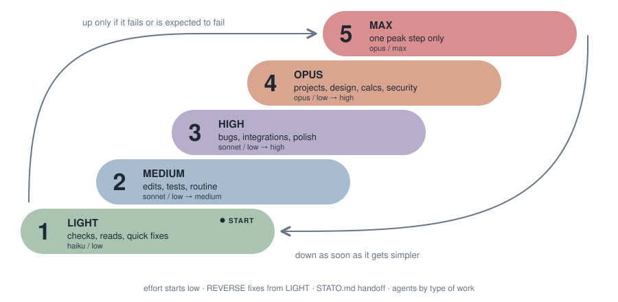

# ONMAKE Gear

The right model at the right moment for the task at hand, with effort matched to the task: excellent work, optimised tokens, always leaning to saving, with excellent quality.




**What it does.** At the start of every Claude Code session, ONMAKE Gear gives the session a rule: pick the lowest model + effort pair that guarantees excellent quality; go up if a check fails, go down when the hard step is done; use a short peak of maximum effort only for the essential step; keep a short `STATO.md` per job; switch model only between operations and say so in one line; REVERSE gear fixes errors starting from the lowest level. The rule in `portabile/GEAR.md` is portable and works with any AI.

| Task | Model | Effort |
|---|---|---|
| Level | Model | Effort | Agents by type of work |
|---|---|---|---|
| LIGHT | Haiku | low | `gear-reader` (reads, search, status), `gear-tester` (tests, checks) |
| MEDIUM | Sonnet | low, then medium | `gear-editor` (known files and lines), `gear-writer` (texts, docs) |
| HIGH | Sonnet | low, then high | `gear-debugger` (unknown bugs), `gear-reviewer` (code review) |
| OPUS | Opus | low, then high | `gear-designer` (interfaces), `gear-architect` (projects), `gear-standards` and `gear-security` (start at medium) |
| MAX | Opus | max, one step only | `gear-max` |

The type of work picks the model; effort starts low whenever the job can be done that way and goes up only when the check fails. Projects (design, architecture, a new interface) start directly at OPUS. REVERSE fixes errors starting from LIGHT.

**Install.**
```
claude plugin marketplace add MaxTulli70/ONMAKE.Gear
claude plugin install onmake-gear@onmake
```
License MIT. Version 0.6.0, in testing.

Italiano: see [README.it.md](README.it.md).

**Bar and panel.** In Claude Code a small bar above the prompt shows the gear (colored pill), tokens, agents working ▶, stalled ⏸, done ✓ and interrupted ✗, work progress from the task list (5 cells, 20% each) and active time; `Dettagli` opens the list of agents and a field to send a command, stop or resume another session of the desktop app; `Pannello` (or `/gear-pannello`) opens a local page with workflow nodes, timeline, tokens per model and per gear, and the estimated saving against doing everything in Opus. Everything is read from local transcripts; prices for the estimate are editable in `~/.config/onmake-gear/prezzi.json`. Settings: position (above, or one line in the status line below), compact, colors.

**Status line.** Shows the current gear, e.g. `⚙ LIGHT ▼` (arrow = last shift up/down, `⚙ –` = no gear sub-agents yet). The desktop app does not draw it; in the terminal, enable it: set `statusLine` in `~/.claude/settings.json` to `{"type":"command","command":"python3 /path/to/onmake-gear/scripts/statusline.py"}`.

## Token counter / Contatore token
`python3 onmake-gear/scripts/contatore.py [transcript.jsonl]` prints tokens per model and per gear level (stdlib only). Claude Code stores sub-agent usage in its own files (`<session>/subagents/agent-*.jsonl`, type in `.meta.json`), so sub-agents are counted separately and the main chat is shown as one row. Streamed duplicates are merged by message id.

## Other AIs / Altre AI
For opencode, DeepSeek Harness (dsh), Codex, Gemini, Cursor: `sh portabile/installa-altre-ai.sh` adds a compact rule block (`portabile/GEAR-corto.md`) to their existing instruction files, backup `*.prima-gear`, safe to re-run. Remove with `sh portabile/installa-altre-ai.sh --togli`.
